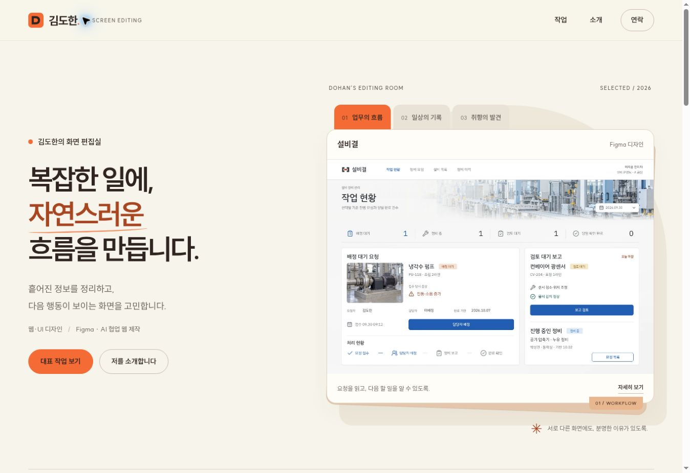

# 김도한 | 웹·UI 디자인 포트폴리오

## 화면 편집실 리디자인 — 2026-10-29

현재 공개 구성의 기준입니다. 사용자가 승인한 크림·주황 팔레트와 화면 편집실 콘셉트를 구현하고, 부드러운 움직임과 자연스러운 읽기 순서를 함께 다듬었습니다.

- 공통 색상은 크림 `#F7F5EB`, 갈색 글자 `#2F241F`, 주황 `#F46B36`입니다. 작은 강조 글자는 대비가 더 높은 `#A84622`를 사용합니다. 실제 작품 이미지는 고유 색상을 유지합니다.
- 홈은 소개와 실제 화면 선택 → 대표작 3개 → 추가 작업 4개 → 두 가지 작업 판단 → 연락 순서입니다. 설비결은 큰 가로 배치, 잔상관·갈피록은 나란한 배치로 구성했습니다.
- 첫 화면의 업무·기록·취향 버튼으로 실제 작품 화면과 상세 링크를 바꿀 수 있습니다. 자동 재생이나 스크롤 가로채기 없이 짧은 전환을 사용하며 `prefers-reduced-motion`을 반영했습니다.
- 목록·소개·일곱 상세 페이지의 표면, 버튼, 여백과 강조색을 통일했습니다. 주요 버튼의 불필요한 화살표를 덜고 D 마크도 주황색으로 맞췄습니다.
- 기준선의 기존 ‘Figma 시안만 소개’ 문구를 수정했습니다. 저장소의 현재 기준선 README와 공개 웹을 확인해 웹사이트 링크, 브라우저 내 상담 시연 범위, 본인과 AI 역할을 갱신했습니다. 소개 표지는 실제 공개 웹의 1363×936 캡처 `public/detail/current/gijunseon-web-20261029.jpg`입니다.
- 사용자가 직접 설명 가능한 Figma 작업과 AI의 코드 작성·검사를 구분했습니다. 이번 구현은 대화에서 승인한 디자인 방향을 적용한 것이며 Figma 원본 수정은 포함하지 않습니다.

### 이번 확인 범위

- `npm run build` 성공, `git diff --check` 통과. 일곱 상세의 이미지 경로 26개가 실제 파일로 존재함을 확인했습니다.
- Chromium 데스크톱 1363px에서 일곱 상세의 제목·바로가기·가로 넘침과 로드 완료 이미지 오류를 확인했습니다. 홈 첫 화면·대표작 배열·연락 구간을 시각 검토했습니다.
- 390px CSS iframe에서 목록·소개·일곱 상세를 확인했습니다. 홈은 320·360·768·1024px에서도 검사했고, 320px의 body 최소 폭에 따른 넘침을 수정했습니다. 수정 뒤 320px 홈과 일곱 상세 모두 문서 가로 넘침이 없었습니다. iframe 폭에는 15px 스크롤바가 포함됩니다.
- 첫 화면의 세 작품 전환, 대표작·연락 이동과 포커스, 목록 업무·관리 필터를 확인했습니다. 기준선 공개 웹의 현재 화면과 링크도 확인했습니다.
- 실제 휴대전화, Safari, 스크린리더, 사용성·채용 성과는 검증 범위가 아닙니다. 동작 감소 설정은 CSS 대응을 반영했으며 운영체제 설정을 바꾼 실기기 검사는 하지 않았습니다.
- 변경 범위는 `projects/my-portfolio`의 홈·공통 스타일·목록/소개/상세, 기준선 소개 데이터와 캡처입니다. 패키지·lockfile·배포 workflow는 변경하지 않았습니다.
- 작업 브랜치 `codex/portfolio-studio-20261029`, 기준 HEAD `fa7ba311aea2105faf2ac3317d51f6a753755cb9`. 기존 인터넷 주소에서 확인하겠다는 사용자 요청에 따라 GitHub Pages의 기존 배포 절차를 사용합니다.



---

## 공통 포트폴리오 편집형 개선 — 2026-10-28

현재 작업 기준은 이 절입니다. 아래의 기존 회차 기록은 당시의 배치와 검증 내용을 보존한 이력입니다.

- 홈을 큰 디자인 부분 화면과 짧은 소개 → 대표 3개 → 본인의 방향 선택 → 추가 4개의 이미지 목록 → 연락 순서로 구성했습니다. 첫 화면의 작은 미리보기 3개를 하나의 큰 실제 Figma 화면으로 바꿨습니다.
- 대표 순서는 설비결 → 잔상관 → 갈피록입니다. 추가 작업은 고른시선 → 기준선 → 온정류 → 소요빛이며, 전체 목록과 다음 작품 링크도 같은 순서입니다.
- 공통 색상은 종이색 `#F6F5F1`, 본문 `#202C31`, 강조 `#315E70`입니다. 작품별 배경과 이미지 크기를 달리하고 잔상관은 어두운 영역으로 구분했습니다. 기존 SUIT Variable과 D 마크는 유지했습니다.
- 현재 독립적으로 수정·설명 가능한 도구는 Figma라는 사용자 답변을 반영했습니다. 웹·UI 디자인과 웹퍼블리싱 학습, AI 협업 웹 제작을 구분했습니다. 제작 기술 목록은 독립 구현 역량의 증거로 표현하지 않습니다.
- Figma 원본은 수정하지 않았습니다. 이번 웹 구성은 사용자가 승인한 점검 의견을 구체화한 구현안이며, 새 Figma 시안을 그대로 옮긴 결과는 아닙니다.

### 현재 화면과 출처

| 작품 | 소개에 사용하는 현재 자료 |
| --- | --- |
| 설비결 | Figma `GInxTqHo6Y87DEe3vuhmMw`, `336:229`, 1440×1080 |
| 기준선 | Figma `3ZJ4TUGqBNAewsJYzheOWo`, `451:747`, 1440×2621 |
| 온정류 | Figma `bzwp6FhsZaaenOA4ABIAFs`, `671:797`, 390×844 |
| 소요빛 | Figma `cvfT9QazAFaXVAxZfeUdvr`, `1289:674`, 390×1114 |
| 갈피록 | 공개 웹의 시작·오늘의 지원·면접 연습, 모바일 시작·면접 화면 |
| 고른시선 | 현재 UI 비교 연습의 PC·모바일 화면. 이전 피드백 보드 소개를 목적·범위와 함께 갱신 |
| 잔상관 | 현재 화면과 일치하는 기존 v37 캡처. 홈·목록·상세 연결을 통일 |

새 원본은 `public/detail/current/*20261028.png` 또는 `.jpg`입니다. Figma 표지용 WebP는 동일 화면의 크기·형식 변환이며 원본 PNG를 보존합니다. 갈피록과 고른시선의 모바일 캡처는 390×844 CSS iframe 렌더링이며 실제 휴대폰 캡처가 아닙니다. 화면의 가상 날짜·수치는 원본 그대로입니다.


### 변경 파일

- 홈 구성: `src/pages/HomePage.jsx`, `src/components/sections/HeroSection.jsx`, `heroSection.css`, `ProjectsSection.jsx`, `MoreWorksSection.jsx`, `DesignNotesSection.jsx`, `ContactSection.jsx`
- 공통 표시: `src/index.css`, `src/theme.js`, `src/components/projects/ProjectCover.jsx`, `projectCovers.css`
- 현재 내용·순서: `src/data/projectsData.js`, `projectsFallbackData.js`, `portfolioMeta.js`
- 목록·상세·소개: `src/pages/ProjectsPage.jsx`, `ProjectDetailPage.jsx`, `portfolioEditorial.css`, `AboutPage.jsx`
- 문서·메타·미리보기: `README.md`, `review-preview.jpg`, `index.html`, `src/components/layout/RouteEffects.jsx`, `vite.config.js`
- 현재 화면 자산: `public/detail/current/*20261028*`

### 검증과 남은 범위

- 최종 `npm run lint` 통과(오류·경고 0), `npm run build` 성공, `git diff --check` 통과.
- Chromium PC에서 상세 7개, 390px CSS iframe에서 상세 7개의 경로와 가로 넘침을 확인했습니다. 목록의 콘텐츠·학습 필터, 다음 작품 이동, 잔상관의 작품/메모 화면 전환, 홈 대표 작업 앵커의 포커스와 이동을 확인했습니다.
- 홈의 360px·390px·820px CSS iframe 및 데스크톱 화면을 확인했습니다. 360px와 820px에서 SUIT 폰트 로딩과 가로 넘침을 확인했습니다. 스크롤바 때문에 문서의 clientWidth는 iframe 폭보다 15px 작습니다.
- 상세 이미지 참조 32개가 실제 파일로 존재함을 확인했습니다. 이는 모든 외부 서비스 기능이나 사용자 과업의 검증을 뜻하지 않습니다.
- 실제 휴대폰·Safari·스크린리더·사용자 조사·채용 성과·운영 계정 인증은 이번 검증 범위가 아닙니다.
- 작업 브랜치: `codex/portfolio-editorial-20261028`, 기준 HEAD: `59d6b533ca92cd7f751a9ef70f39f676b73b6dde`. 구현과 검토를 완료한 기준입니다. 기존 main 작업 폴더는 변경하지 않았습니다.
- 2026-10-29 사용자 승인에 따라 기존 GitHub Pages 배포 절차로 공개 반영합니다. 개별 작품의 서비스 코드, 패키지·lockfile, CI/CD, Figma 원본은 변경하지 않았습니다.

---

공개 주소: https://kdhan0320-bot.github.io/dohan-portfolio/my-portfolio/

## 잔상관 소개 갱신 — 2026-10-26

- 잔상관에 한해 홈·영화 찾기·보관함·메모·큐레이션의 실제 PC·모바일 화면을 v36 캡처로 갱신했습니다. 메모는 검사 브라우저의 시연 예시이며 운영 사용자 데이터가 아닙니다.
- PC 소개에서 보관함 조작부, 메모 팝업, 큐레이션 설명·추천작을 실제 화면 일부로 보여주고 전체 화면 원본도 연결했습니다. 가상의 완성 화면으로 합성하지 않았습니다.
- 이미지 우선·글자 크기 유지 요청과 사용자가 전달한 갤러리/짧은 팝업 피드백을 구현 결과에 연결했습니다. 김도한과 AI의 기존 역할 구분, 가상 작품·AI 생성 이미지·브라우저 저장 및 미검증 범위는 유지합니다.
- 기존 글자 크기·굵기와 소개 공통 스타일은 변경하지 않았습니다. 기존 lint·build와 Chromium 화면/원본 링크/보기 선택 검사를 사용합니다.

## 이전 회차 확인 — 2026-10-16 모바일 읽기 순서·현재 화면

- 갈피록 사용 흐름은 모바일·태블릿(1100px 이하)에서 단계 버튼→행동·결과 설명→캡처 순서입니다. 넓은 PC는 화면 왼쪽·설명 오른쪽 배치를 유지합니다. 숨긴 단계의 높이 예약과 접근성 처리를 유지했습니다.
- 실제 브라우저 2560×1440·390×844·360×800에서 네 단계 전환 전후 버튼과 스크롤 위치가 같았습니다. 360px에서는 버튼 끝과 설명 시작 간격 14px를 확인했습니다. 1024×900에서도 설명 다음 캡처 순서와 가로 넘침 없음을 확인했습니다. 이는 해당 동작의 측정이며 전체 CLS나 사용성 성과 수치가 아닙니다.
- 김도한의 기록·조작 우선 요청과 큰 화면 배치 피드백, 갈피 유지·그라데이션 선택을 실제 대화 범위로 구체화했습니다. AI의 디자인·구현·검사 역할을 별도로 표시합니다. 독립 수행 능력은 문구 수정만으로 증명되지 않습니다.
- `galpirok-overview.jpg`를 준비 목록 두 열·아래 면접 영역으로 정리한 실제 2560×1440 화면으로 교체했습니다. PNG 원본을 System.Drawing JPEG 품질 94로 형식만 변환했습니다.
- 포트폴리오 lint 오류·경고 0, production build 성공. 연결된 갈피록의 기존 코드 테스트 57개와 build 성공, lint 오류 0·기존 Fast Refresh 경고 1. 실제 계정 인증·DB 저장 유지·모바일 실기기·사용자 조사·채용 성과는 검증하지 않았습니다.

## 현재 갈피록 소개

- 제목·서비스 목적·바로가기 → 김도한과 AI의 역할 → 실제 홈 화면 → 한 회사의 지원 과정 → 세 판단 사례 → 구현·검증 범위 순서입니다.
- 지원할 회사를 직접 등록해 상태·마감·준비를 연결하는 목적을 첫 설명에 둡니다. 실제 구조를 보여주는 흐름과 화면 개선 사례를 구분합니다.
- 사용 흐름은 캡처를 선택하는 기능입니다. 모바일 마감 비교는 같은 위치에서 이전·현재를 선택하고 전체 원본도 열 수 있습니다. 준비 체크 비교는 **현재의 두 상태**이며 전후 성과로 표현하지 않습니다.
- 김도한의 기록·조작 우선 요청, 큰 화면 배치 피드백, 갈피 유지·그라데이션 선택을 구현 결과와 연결해 설명합니다. AI가 발견한 동작 문제·디자인·구현·검사는 별도로 표시하며, 본인의 독립 수행 능력이나 사용자 조사·채용 성과로 바꾸지 않습니다.

현재 사용법·역할·경로는 아래를 따릅니다. 지난 배치·캡처·검사 수치는 문서 끝의 접힌 이력에 보존했으며 최신 수정의 결과로 확대하지 않습니다.

## 현재 디자인 기준

사용자가 요청한 전면 리디자인을 코드에 반영했다. 첨부된 건축 포트폴리오의 편집 그리드와 회청색 레퍼런스를 참고하되, 외부 템플릿 이미지·코드는 포함하지 않는다. 이전 Human Signal Figma 화면을 그대로 구현한 버전이 아니다. 이번 구현에서는 Figma 원본을 수정하지 않았다.

- 배경 `#F7F8FA`, 본문 `#202B36`, 보조 `#536371`, 강조 `#345F86`, 보조면 `#E4ECF3`.
- SUIT Variable을 기존 설치 패키지에서 자체 번들링한다. 별도 Google Fonts 요청은 없다.
- 메인은 이름·지원 분야와 실제 작업 화면 → 대표 3개 → 추가 4개 → 짧은 소개 → 연락 순서다. 회사명과 상세 경력, 본인·AI 기여는 독립 `/about` 소개 페이지에서 다룬다.
- 대표는 설비결·갈피록·잔상관, 추가 작업은 기준선·고른시선·온정류·소요빛이다. 각 표지는 기존 실제 화면을 CSS로 구성한다. PC 표지는 상단·좌우 7%, 화면 너비·높이 86%로 맞추고 모바일 표지는 같은 높이로 나란히 배치한다. 표지의 중복 문구·하단 띠·겹침을 없앴으며 상세의 원본 화면은 비율을 보존한다.
- 최대 콘텐츠 폭 1280px, 기본 한글 본문 16px 이상. 모바일은 단일 열, 큰 화면의 목록은 2열이다.
- 상단 메뉴는 작업·소개·연락이다. 헤더와 파비콘은 동일한 단순 D 모노그램 SVG를 사용한다. 홈의 장식 화살표와 CTA 안의 화살표를 제거하고, 링크의 버튼 스타일·텍스트 밑줄·포커스 표시로 동작을 구분한다. 상세의 뒤로·다음 탐색은 방향 표시를 유지한다.
- 첫 화면에는 지원 분야와 신입 지원을 함께 표시하고, 작품 미리보기에는 실제 서비스 종류를 적는다. 아래 대표작에서 설비결의 정비 요청, 갈피록의 오늘의 지원 화면을 보여주어 첫 화면과 중복을 줄인다.
- 소개의 검토·개선 사례는 김도한이 실제로 제기한 이 포트폴리오의 썸네일·화살표·경력 배치 피드백이다. 본인의 문제 제기·방향 승인과 AI의 편집·코드 수정을 구분한다.
- 사무·생산 경력과 디자인·웹퍼블리싱 신입 지원을 구분한다. 근속기간·직급·성과 수치를 추정해 넣지 않는다. 공개 이력서 파일은 새로 연결하지 않았다.

## 화면과 경로

| 경로 | 내용 |
| --- | --- |
| `/` | 메인, 대표·추가 작업, 짧은 소개, 연락 |
| `/about` | 작업 배경, 이전 경력, 본인과 AI의 제작 기여 |
| `/projects` | 공개 작업 7개와 전체/업무·관리/생활 서비스/콘텐츠 필터 |
| `/projects/jobflow` | 갈피록 |
| `/projects/seolbiit` | 설비결 |
| `/projects/ott-service` | 잔상관 |
| `/projects/gongjeongbom` | 기준선 |
| `/projects/feedback-hub` | 고른시선 |
| `/projects/bus-arrival` | 온정류 |
| `/projects/brewstep` | 소요빛 |

HashRouter를 사용한다. 기존 외부 링크를 유지하기 위해 내부 slug는 변경하지 않았다. 기본 상세는 제목·바로가기·본인과 AI의 기여·실제 화면 → 배경 → 화면과 판단 → 제작 범위·한계 순서다. 이미지 원본 링크를 제공하며 같은 이미지를 반복 나열하지 않는다. 설비결은 실제 이전·현재 화면을 비교한다. 갈피록과 잔상관은 아래에 기록한 화면 우선 구성을 사용한다. 본인의 독자 설계나 사용자 검증 성과로 표현하지 않는다.

갈피록 소개는 제목·바로가기 → 김도한·AI 역할 요약 → 실제 홈 화면 → 같은 회사의 네 단계 사용 흐름 → 판단과 기본 노출된 비교 → 구현 범위·한계 순서입니다. 모바일 첫 이미지는 홈의 첫 화면이며 부분 보기용 상하 자르기를 하지 않습니다. 사용 흐름은 모션브릿지의 지원 예정 기록, 마감 확인, 연결된 준비 항목 완료, 지원 완료로 저장한 상태를 선택해 보는 실제 캡처입니다. 준비 체크는 동일한 2560×1440의 현재 두 필터 상태를 선택해 비교하며, 개선 전후가 아닙니다. 빈 결과의 안내 문구까지 포함해 어떤 상태인지 읽을 수 있게 표시합니다. 모바일 마감은 390×844의 이전·현재 화면에서 같은 영역을 부분 표시합니다. PC에서는 나란히, 모바일에서는 개선 전·후 선택으로 비교하며 개선 후가 기본입니다. 전체 원본 링크를 유지합니다.

김도한의 목적·우선순위·화면 피드백·방향 선택·공개 판단과 AI의 구체적인 디자인·코드·검사·캡처를 역할 표에서 구분합니다. 큰 화면의 배치·문서 같은 인상·큰 그림 문제는 김도한의 피드백이며, 필터 이동과 모바일 마감 누락은 AI 검토에서 발견한 문제로 표시합니다. 이를 독립 디자인·구현이나 사용자 조사·채용 성과로 확대하지 않습니다.

상세의 이미지에는 메타에 기록된 원본 비율로 `width`·`height`를 지정해 지연 로딩 전에 공간을 확보합니다. `<picture>`의 모바일 `<source>`에도 별도 원본 치수를 지정합니다. 갈피록 PC 사용 흐름의 회사 상세·마감·준비 화면은 원본 치수와 별도로 `media.crop` 비율을 표시 영역에 예약하고, 위치·너비만 CSS로 조정합니다. 회사 상세는 원본의 540px 영역을 잘라 표시하며 실제 표시 최대 폭은 390px입니다. 모바일 비교도 최대 390px를 유지합니다. 모바일에서는 PC 부분 보기 규칙을 해제하며 모바일 홈의 이전 부분 보기 비율도 사용하지 않습니다. 잔상관의 내용과 표시 구성은 이번 변경 범위가 아닙니다.

잔상관 v35 상세는 제목·짧은 목적·바로가기 → 현재 홈 화면 → 실제 역할·AI 범위 → 사용 가설과 두 선택·증거 → 큐레이션의 선정 이유 → 제작 범위·검증 한계 순서입니다. PC 첫 결과는 실제 가로 목록의 6–9번째 위치이며, 모바일에서는 실제 모바일 홈 첫 화면을 표시합니다. 김도한의 방향·피드백·우선순위·공개 판단과 AI의 디자인·큐레이션 제안·이미지·코드·검사를 역할 표에서 명시합니다. 두 선택은 이미지 비중과 탐색/비교 구분, 메모 읽기·수정 분리의 문제·선택·결과와 감수점을 설명합니다. v35에서는 반복 문장과 중첩 여백을 줄이고, 서비스의 새 이미지 두 장과 PC 읽기 행이 반영된 실제 캡처 8장을 갱신했습니다. 글자 크기·굵기·행간·실제 역할은 유지하며 사용자 조사나 독립 구현·채용 성과를 추가하지 않습니다.

본문 증거는 홈·영화 찾기·보관함·큐레이션 네 자리입니다. 보관함 자리에서는 ‘작품 훑기 / 메모 보기’ 버튼으로 실제 시연 캡처 하나씩을 선택합니다. 훑기의 세 작품과 같은 작품의 읽기 기본 팝업을 연결하며, 실제 서비스의 상태를 변경하는 버튼은 아닙니다. PC 본문은 조작부·카드 또는 팝업 영역을 표시하고 원본 링크는 해당 전체 뷰포트로 이어집니다. 모바일 훑기 원본은 같은 상태의 전체 페이지입니다. 보관함과 큐레이션 증거는 1100px까지 모바일 캡처·캡션·원본 링크를 함께 사용하고, 모바일 이미지는 원본 390px보다 확대하지 않습니다. 말미는 중복 소제목과 세 목록 대신 ‘구현과 데이터 / 제공하지 않는 기능’의 두 문단으로 묶고, 브라우저 저장·가상 작품·AI 이미지·미검증 범위는 남깁니다. 다른 프로젝트 상세와 기존 글자 크기·굵기는 유지합니다.

## 정보의 기준

- `src/data/projectsFallbackData.js`: 공개 이름·소개·역할·도구·외부 링크·제작 범위.
- `src/data/projectsData.js`: 정렬·현재 썸네일 URL·화면 유형.
- `src/data/portfolioMeta.js`: 메인 메타와 상세의 설명·화면 연결.
- `src/index.css`: 공통 팔레트·헤더·메인·버튼·연락.
- `src/components/projects/ProjectCover.jsx`, `projectCovers.css`: 기존 실제 화면을 활용한 주제별 표지.
- `src/pages/AboutPage.jsx`, `aboutPage.css`: 독립 소개, 이전 경력·현재 지원 분야·본인과 AI의 기여.
- `src/components/sections/HeroSection.jsx`, `heroSection.css`: 큰 이름과 지원 분야, CSS 그림자 배경, 실제 화면의 짧은 단발 등장 모션.
- `src/constants/site.js`: PDF 경로. 현재 파일이 준비되지 않아 null이며 버튼을 노출하지 않는다. 실제 경로를 설정하면 데스크톱 헤더와 홈에서 다운로드 링크를 제공한다.
- `src/pages/portfolioEditorial.css`: 전체 작업과 상세 페이지.
- `src/theme.js`: MUI 기본 테마. 기존 보관 컴포넌트와의 호환을 위해 legacy export 이름을 유지한다.

갈피록·고른시선·잔상관은 웹 결과물을 연결한다. 기준선·설비결·온정류·소요빛은 현재 Figma 디자인으로 표시한다. 최신 Figma 화면을 이전 웹 구현이나 완전한 프로토타입으로 설명하지 않는다.

가상 데이터·브라우저 메모리·localStorage·실제 서버 저장은 각 프로젝트의 현재 코드와 상세 설명에서 구분한다. 사용자 조사나 채용 성과 수치를 임의로 만들지 않는다. 김도한의 요구사항·피드백·방향 선택과 AI의 디자인 제안·편집·구현 참여를 구분한다.

v27에서는 소개 구조와 글자 크기·굵기를 유지한 채 현행 탐색 조작·상세의 찜 아이콘·메모 단일 진입을 두 결정 설명 안에 반영했습니다. 첫 결과 이미지는 홈의 분위기별 포스터 탐색 위치를 보여줍니다. 새로운 사용자 조사·성과·독립 구현 기여를 추가하지 않았습니다.

## 현재 이미지

실제 브라우저 캡처를 사용하며 AI로 화면을 생성하거나 글자를 교체하지 않습니다. 아래는 `public/detail/current/`에 보관한 갈피록 이미지의 저장 치수입니다. 새 캡처와 기존 캡처의 재사용, 표시 영역 변경은 `docs/asset-license-register.md`의 해당 이력에서 구분합니다.

| 파일 | 화면 범위 | 저장 픽셀 |
| --- | --- | --- |
| `galpirok-welcome.jpg` | PC 홈 | 1440×900 |
| `galpirok-welcome-mobile.jpg` | 모바일 홈 첫 화면 | 375×812 |
| `galpirok-overview.jpg` | 오늘의 지원 | 2560×1440 |
| `galpirok-board.jpg` | 지원 현황 | 2560×1440 |
| `galpirok-calendar.jpg` | 마감 일정 | 2560×1440 |
| `galpirok-checklist-wide.jpg` | 큰 화면 준비 체크 | 2560×1440 |
| `galpirok-checklist-filter-all-v2.png` | 현재 전체 분류·진행 중 5개 | 2560×1440 |
| `galpirok-checklist-filter-empty-v2.png` | 현재 기타 분류·빈 결과 | 2560×1440 |
| `galpirok-calendar-mobile.jpg` | 모바일 마감 목록 | 390×844 |
| `galpirok-register.jpg` | PC 회사 등록 | 1440×900 |
| `galpirok-register-mobile.jpg` | 모바일 회사 등록 | 390×844 |
| `galpirok-flow-record.jpg` | 모션브릿지 지원 예정 상세 | 1440×900 |
| `galpirok-flow-record-mobile.jpg` | 같은 기록의 모바일 상세 | 390×844 |
| `galpirok-flow-deadline.jpg` | 모션브릿지 마감 확인 | 1425×990 |
| `galpirok-flow-deadline-mobile.jpg` | 같은 마감의 모바일 목록 | 390×844 |
| `galpirok-flow-ready.jpg` | 모션브릿지 준비 항목 완료 | 1440×900 |
| `galpirok-flow-ready-mobile.jpg` | 같은 준비 완료의 모바일 화면 | 390×844 |
| `galpirok-flow-applied.jpg` | 모션브릿지 지원 완료 상세 | 1440×900 |
| `galpirok-flow-applied-mobile.jpg` | 같은 지원 완료의 모바일 상세 | 390×844 |

PC 기본·회사 상세·준비 흐름은 CSS viewport 1440×900, PC 마감 흐름은 1440×1000, 큰 화면 4개는 2560×1440, 모바일은 390×844입니다. 캡처 도구가 모바일 홈을 375×812, PC 마감 흐름을 1425×990으로 반환한 경우에는 반환된 픽셀 치수를 유지했습니다. 00f5120에서 갱신한 홈 PC·모바일, 오늘의 지원, 준비 완료 JPEG는 PNG 캡처를 System.Drawing 품질 94로 변환했습니다. 그 이전 JPEG의 Pillow 품질 91 변환 기록은 해당 제작 이력에만 적용합니다. 준비 체크 필터 두 상태는 브라우저가 반환한 PNG 원본입니다. 캡처 후 자르기·크기 변경·합성·글자 교체는 하지 않았습니다.

사용 흐름의 PC 부분 보기 좌표는 회사 기록·지원 완료 x885/y0/540×900, 준비 완료 x53/y169/1320×650, 마감 확인 x32/y167/1347×772입니다. 원본 파일은 그대로 두고 CSS로 표시 영역만 지정하며 부분 보기 캡션과 전체 원본 링크를 제공합니다. 760px 이하에서는 대응 모바일 이미지·캡션·원본 링크로 전환하고 상하 자르기를 하지 않습니다. 모바일 홈도 375×812 저장 비율의 첫 화면 전체를 표시합니다. 준비 체크의 현재 두 상태는 PC x630/y270/1265×610, 모바일 x918/y383/360×315를 표시합니다. 모바일 마감의 이전·현재 비교는 두 원본에서 같은 x15/y125/345×505 영역을 표시합니다.

기존 `galpirok-checklist.jpg`, `galpirok-checklist-mobile.jpg`, `galpirok-board-mobile.jpg`와 비교용 이전 원본 2개는 이번에 갱신하지 않았습니다. 지난 캡처의 치수·제작 이력은 아래에 보존합니다. 메인·작업 목록 표지는 최신 보드·오늘의 지원 원본을 사용하고, 작업 영역 시작 y237에 맞춰 CSS의 세로 위치를 `-15.192%`(237/1560)로 조정했습니다. 별도 합성 그림이나 AI 비트맵 자산은 추가하지 않았습니다. 상세 출처는 `docs/asset-license-register.md`의 최신 절을 따릅니다.

## 실행과 검증

```bash
npm run dev
npm run lint
npm run build
```

기존 `tools/site-audit-kit`의 기준처럼 실제 렌더링에서 h1·이미지 로딩·가로 넘침·콘솔 오류·키보드 이동을 확인한다. 새 디자인의 시각 검토는 자동 검사와 구분한다. 브라우저 시뮬레이션은 모바일 실기기 검증을 뜻하지 않는다. 새 첫 화면의 모션은 약 1.1초 안에 끝나고 반복하지 않으며, 움직임 감소 설정에서는 실행하지 않는다. 모션이 끝나기 전에도 메뉴와 버튼은 사용할 수 있다.

실행한 검사는 해당 회차의 결과에만 기록합니다. 과거 회차의 통과 수치로 최신 변경을 검증했다고 표현하지 않습니다.

## 운영

`main` push는 기존 GitHub Actions 배포를 실행하므로 commit·push·deploy는 루트 `AGENTS.md`의 승인 기준을 따른다. 이번 디자인 작업은 패키지·lockfile·workflow·DB·secret을 변경하지 않는다.

## 이전 구현·캡처·검증 이력

아래의 ‘현재’·‘최신’·‘이번’은 각 기록 당시를 뜻합니다. 화면 좌표와 통과 결과는 기록된 버전·검사 범위에만 적용합니다.

<details>
<summary>이전 갈피록 소개 변경과 확인 기록</summary>

### 00f5120 회차 확인 — 2026-10-16 샘플 진입·화면 안정성 정리

- 기존 자동 테스트 57개 통과. 실제 계정 인증이나 DB 통신을 실행한 결과는 아닙니다.
- 갈피록 전체 lint 오류 0, 기존 AuthContext Fast Refresh 경고 1. 포트폴리오 lint 오류·경고 0. 두 production build 성공, 이번 빌드에 큰 번들 경고 없음.
- 실제 브라우저 viewport 2560×1440에서 홈·로그인·오늘의 지원·준비 체크, 1440×900과 1024×900에서 관련 작업 영역을 확인했습니다. 모바일 390×844·360×800에서 홈·로그인·입력창·면접 답변·포트폴리오를 확인했습니다. 모바일 실기기 검사와는 구분합니다.
- 홈과 로그인 샘플 버튼은 모두 오늘의 지원으로 이동합니다. 로그인 도움 화면에서 돌아오기, 면접 초안 작성→로그인→샘플 진입→복원→저장을 확인했습니다. 샘플 회사 등록과 상태·메모·날짜 수정 후 다시 열기, 준비 항목 완료도 확인했습니다. 테스트 기록은 샘플 메모리에만 만들었습니다.
- 360px 마감 일정에서 9월과 10월의 가까운 마감 노출, 날짜 탐색 펼침·다음 달 날짜 선택·다가오는 마감 복귀를 확인했습니다.
- 2560px 준비 체크 전체→기타 빈 결과 전환에서 필터 y387과 scrollY0 유지. 포트폴리오 네 단계 선택은 2560px(scrollY713, 버튼 y692.1875), 390px(1080,397.515625), 360px(1158,375.65625)에서 전환 전후 위치가 같았습니다. 모바일 비교의 빈 안내 글자와 마감 개선 전·후 선택도 확인했습니다. 측정 당시의 위치이며 모든 페이지의 CLS 점수는 아닙니다.
- 실제 계정 인증·DB 저장 유지·실기기·사용자 조사·채용 성과는 검증하지 않았습니다. 기여 설명은 김도한의 목적·문제 제기·방향 선택과 AI의 구체적인 디자인·코드·검사로 구분합니다.

## 최신 구현 — 2026-10-16 읽을 수 있는 비교와 선택의 이유

- 준비 체크의 두 상태를 접힌 전체 화면 두 장 대신, 기본 노출되는 `전체 분류 · 5개 / 기타 분류 · 0개` 선택으로 비교합니다. PC는 제목·필터·목록 작업 영역, 모바일은 같은 PC 원본의 상태 탭과 목록 시작을 CSS 부분 보기로 표시합니다. 모바일 화면이라고 바꾸어 부르지 않으며, 두 상태에 같은 자르기 좌표를 적용하고 전체 2560×1440 원본 링크를 유지합니다.
- 모바일 마감의 개선 전후 화면도 기본 노출합니다. 같은 가상 회사의 4단계 사용 흐름은 유지하고 추가로 반복하지 않습니다.
- 김도한과 AI의 역할은 첫 부분에 짧게 구분합니다. 판단 사례는 상단 쏠림을 줄이면서도 필터의 위치를 지키는 선택, 큰 그림 대신 그라데이션·작은 갈피 표시를 남기는 선택, 모바일에서 가까운 마감을 먼저 보이는 선택과 그 이유를 설명합니다. 본인의 독립 코딩·사용자 조사·채용 성과를 주장하지 않습니다.
- 실제 브라우저 2560×1440·390×844·360×800에서 비교 화면과 선택 전환을 확인했습니다. 390px에서 두 상태를 바꿔도 이미지 영역의 위치·높이와 페이지 스크롤이 같았고, 360px에서 Enter 선택과 2560×1440 원본 링크를 직접 열어 확인했습니다. 검사한 화면에서 가로 넘침과 로딩 완료 후 깨진 이미지는 없었으며 브라우저 오류·경고 로그도 없었습니다. 실기기·전체 사이트 CLS·채용 효과 검증은 아닙니다.
- 이미지 파일 자체와 다른 프로젝트의 내용은 변경하지 않았습니다. 홈·회사 흐름의 원본은 기존 캡처를 재사용합니다. 새 캡처로 설명하지 않습니다.

아래는 이전 구현·검증 이력입니다. 비교의 기본 노출과 부분 보기 방식은 위 최신 기록을 따릅니다.

## 이전 이력 — 2026-10-16 역할을 먼저 보여주는 소개와 현재 필터 상태 비교

- 갈피록 상세는 제목·서비스 목적·바로 보기 링크 다음에 김도한과 AI의 역할 요약을 표시합니다. 뒤쪽에 반복되던 역할·목적 설명을 줄이고, 실제 홈 화면 → 같은 회사의 지원 흐름 → 판단과 근거 → 구현·검증 범위 순서로 정리했습니다.
- 김도한의 기여는 서비스 목적·우선순위 설정, 화면의 문제 제기와 수정 요청, 갈피·그라데이션 방향 선택, 공개 판단입니다. 구체적인 화면·스타일 제안, 코드 작성·수정, 샘플·코드 검사와 브라우저 조작·캡처는 AI의 역할로 표시합니다. 본인의 독립 디자인·구현, 사용자 조사나 채용 성과를 추가로 주장하지 않습니다.
- 갈피록 홈 소개 이미지는 PC에서 최대 폭 1000px, 모바일에서 280px로 표시합니다. PC 사용 흐름의 세로형 회사 상세는 표시 폭을 390px로 제한하고 설명을 옆에 묶었습니다. 실제 원본 비율과 원본 보기 링크를 유지하며, 파일 자체를 다시 자르거나 크기를 변경하지 않았습니다. 모바일 본문은 16px를 유지합니다.
- 준비 체크 비교는 과거의 초기 배치와 현재 배치 대신, **현재 버전의 전체 분류와 기타 분류의 빈 결과**를 보여줍니다. 새 PNG 두 개는 동일한 CSS viewport 2560×1440, 스크롤 0에서 캡처했으며 저장 픽셀도 2560×1440입니다. 두 상태에서 작업 영역 시작 y237·상태 탭 y391이 같음을 확인했습니다. 이는 현재의 필터 전환 안정성에 대한 근거이며 수정 전후의 성과 비교가 아닙니다.
- 로컬 실제 브라우저의 2560×1440·390×844에서 갈피록 소개의 배치와 이미지 로딩을 확인했습니다. 포트폴리오 lint 오류 0개, production build 성공을 확인했습니다. 이 결과를 전체 기기·전체 기능의 검증으로 확대하지 않습니다.
- 샘플은 2026.09.27 기준이며 저장된 샘플 기록은 새로고침하면 초기화됩니다. 실제 계정 인증·DB 저장 유지, 모바일 실기기, 사용자 조사·채용 효과는 이번 범위가 아닙니다. Figma 원본은 수정하지 않았습니다.

아래 절은 이전 구현·검증 이력입니다. 현재 소개 순서와 필터 비교 방식, 이미지 표시 폭은 위 최신 기록을 따릅니다.

## 이전 이력 — 2026-10-16 고정된 작업 위치와 같은 회사의 지원 흐름

- 갈피록 소개는 실제 홈 화면 다음에 같은 가상 회사인 모션브릿지의 기록 → 마감 → 준비 완료 → 지원 완료를 보여줍니다. 모바일에서는 단계 선택 버튼을 한 줄로 두고, 실제 화면 다음에 행동과 상태 규칙을 설명합니다. 선택 버튼은 캡처를 전환하며 서비스 데이터를 수정하지 않습니다.
- 회사 기록의 ‘지원 예정’ 상태에서 마감을 확인하고, 회사에 연결된 준비 항목을 완료한 뒤 ‘지원 완료’로 바꾸는 순서입니다. 마감 목록이 관심·지원 예정 상태만 표시하고, 준비 항목의 완료가 지원 상태를 자동 변경하지 않는다는 규칙을 명시했습니다.
- 김도한의 목적·우선순위 설정, 상단 쏠림·문서 같은 인상·배경 그림에 대한 문제 제기, 갈피 정체성과 그라데이션 방향 선택, 수정 요구·공개 판단을 AI의 구체적인 화면·코드 구현, 검사·캡처와 구분했습니다. 본인의 독립 구현·사용자 조사·채용 성과로 확대하지 않습니다.
- 서비스의 큰 폴더 배경은 은은한 CSS 그라데이션으로 바꾸고, 갈피 정체성은 로고·단계 탭·선택 상태에 남겼습니다. 내부 작업 영역은 필터 결과의 길이가 달라져도 일정한 위치에서 시작합니다. 홈의 소개 배치와 내부 작업 화면의 배치 원칙을 구분했습니다.
- 실제 샘플 조작을 통해 2560×1440 준비 체크에서 전체 → 기타 → 전체 → 완료로 바꿔도 작업 영역 시작 y237, 제목 y283, 필터 y387이 유지되는 것을 확인했습니다. 모바일 마감 일정의 첫 기록은 390×844에서 이전 약 y497에서 현재 약 y342로 올라왔습니다. 이는 화면 좌표의 실측이며 작업 속도·사용자 만족도 향상 수치가 아닙니다.
- 준비 체크·모바일 마감의 이전·현재 비교는 펼쳐 보는 보조 증거로 유지합니다. PC 사용 흐름은 실제 작업 영역을 CSS 부분 보기로 표시하고 전체 원본 링크를 제공합니다. 모바일 홈과 흐름 이미지는 캡처된 첫 화면을 원본 비율로 보여주며 추가 상하 자르기를 하지 않습니다.
- 실제 캡처 17개를 갱신·추가했습니다. 이미지와 모바일 `<source>`의 실제 저장 치수, PC 부분 보기 영역의 비율을 구분해 공간을 예약합니다. 선택 단계 변경 시 이미지도 새로 교체해 이전 단계의 그림이 새 설명과 함께 남지 않게 했습니다. 전체 사이트의 CLS 점수를 측정했다는 뜻은 아닙니다.
- 이번에 완료한 코드 검사는 갈피록 자동 검사 41개 통과, 두 프로젝트의 빌드 성공·린트 오류 0개입니다. 포트폴리오는 최종 이미지와 표지 위치 수정을 포함한 production build를 확인했습니다. 갈피록의 기존 `AuthContext.jsx` Fast Refresh 경고 1개는 남아 있습니다.
- 포트폴리오 브라우저에서 2560×1440의 홈 표지·대표작·기여 설명·PC 비교, 1440×1000의 사용 흐름 4단계, 390×844·360×800의 단계 선택·이미지 전환·모바일 비교를 직접 확인했습니다. 모바일의 4개 단계 버튼은 한 줄·높이 48px이며 실제 이미지가 설명보다 먼저 나옵니다. 확인한 화면에서 로딩 실패 이미지와 가로 넘침, 브라우저 오류 로그가 없었습니다. 전체 기기·모든 페이지의 무결성을 뜻하지 않습니다.
- 샘플은 2026.09.27 기준이며 새로고침하면 초기화됩니다. 실제 계정 인증·DB 저장 유지, 모바일 실기기, 사용자 조사·채용 성과는 이번 검증에 포함하지 않습니다. Figma 원본은 수정하지 않았습니다.

## 이전 이력 — 2026-10-16 서비스 흐름과 실제 기여 중심의 소개

- 갈피록 상세는 회사 등록 → 상태 변경 → 마감 확인 → 준비 완료의 네 단계에서 실제 캡처를 선택해 볼 수 있습니다. 설명 순서는 짧은 제목·행동 → 실제 화면 → 구성 이유이며, 소개의 선택 버튼이 서비스 데이터를 변경하지는 않습니다.
- 김도한의 기여는 서비스 목적·우선순위 설정, 상단 쏠림과 문서 같은 인상에 대한 피드백, 갈피·폴더 방향 선택, 개선 요구·공개 판단으로 정리했습니다. AI가 구체적인 화면·그래픽 제안, 코드 작성·수정, 샘플·코드 검사와 캡처를 수행한 범위를 따로 표시합니다.
- 큰 화면의 준비 체크와 모바일 마감 전후 비교는 기본적으로 접힌 보조 증거입니다. 펼치면 이전·현재 원본 비율과 링크를 확인할 수 있습니다. 큰 화면은 내용에 맞춘 작업 영역의 높이와 상하 여백 배분을 설명하며, 사용자 만족도·작업 속도·채용 효과의 향상을 주장하지 않습니다.
- PC 보드·달력의 2560×1440 원본은 보존하고 CSS로 실제 작업 영역만 크게 보여줍니다. 부분 보기 캡션과 전체 원본 링크를 함께 제공하며, 760px 이하에서는 모바일 원본으로 전환하고 PC 부분 보기 규칙을 해제합니다.
- 이미지의 실제 원본 치수와 부분 보기 영역의 비율을 각각 예약합니다. 모바일 소스에도 실제 치수를 지정합니다. 이는 공간 확보 구현이며 이번 기록에 전체 사이트의 CLS 측정 결과를 추가하지 않습니다.
- 샘플은 2026.09.27 기준 가상 데이터이며 새로고침하면 초기화됩니다. 이번 범위는 샘플·코드·브라우저 검증이며 실제 계정의 인증·DB 저장 유지, 모바일 실기기, 사용자 조사·채용 성과 검증은 포함하지 않습니다.

아래 이전 확인 이력은 당시 실행한 범위입니다. 현재 이미지의 치수와 표현 방식은 이 문서의 ‘현재 이미지’ 및 `docs/asset-license-register.md`의 최신 절을 따릅니다.

## 이전 확인 이력 — 2026-10-16 큰 화면·모바일 개선

- 갈피록의 로컬 실제 브라우저에서 2560×1440·1440×900의 홈과 주요 5개 화면, 1280×720 면접 연습, 768×1024 준비 체크, 390×844·360×800의 주요 화면을 확인했습니다. 이는 브라우저 화면 크기 검사이며 모바일 실기기 검사는 아닙니다.
- 가상 샘플에서 회사 등록·수정·삭제, 준비 항목 등록·수정·완료·삭제·필터, 면접 질문과 답변 저장·복습·새로고침 초기화, 마감 목록의 월 경계·날짜 선택·접기를 실행했습니다. 실제 계정의 인증과 DB 저장 유지는 실행하지 않았습니다.
- 포트폴리오의 홈 표지·갈피록 상세를 PC와 모바일에서 확인했습니다. 모바일 비교 이미지의 부모 폭도 명시해 지연 로딩 전후 같은 공간을 유지하게 했습니다. PC 1440px에서 해당 이미지 영역의 로딩 전후 크기가 모두 388×839.65625 CSS px인 것을 확인했으며 전체 사이트의 CLS 점수를 측정했다는 의미는 아닙니다.
- 갈피록 자동 검사 41개 통과, 두 프로젝트 빌드 성공, 린트 오류 0개입니다. 갈피록의 기존 `AuthContext.jsx` Fast Refresh 경고 1개는 남아 있습니다.
- 아래 이전 작업 이력의 검증 범위와 화면 치수는 당시 기록이며 이번 결과로 확대 해석하지 않습니다.

</details>

<details>
<summary>이전 이미지 갱신 기록</summary>

### 이전 이력: 2026-10-16 서비스 흐름과 화면 밀도 보완

2026-10-16 서비스 흐름 보완에서 실제 브라우저 캡처 8개를 교체하고 3개를 추가했습니다. 파일은 `public/detail/current/`에 있으며 저장 치수를 직접 읽어 메타에 반영했습니다.

| 파일 | 변경 | 저장 픽셀 |
| --- | --- | --- |
| `galpirok-welcome.jpg` | 교체 · PC 홈 | 1440×900 |
| `galpirok-overview.jpg` | 교체 · 오늘의 지원 | 2560×1440 |
| `galpirok-board.jpg` | 교체 · 지원 현황 | 2560×1440 |
| `galpirok-calendar.jpg` | 교체 · 마감 일정 | 2560×1440 |
| `galpirok-checklist.jpg` | 교체 · PC 준비 체크 | 1425×891 |
| `galpirok-checklist-wide.jpg` | 교체 · 큰 화면 준비 체크 | 2560×1440 |
| `galpirok-checklist-mobile.jpg` | 교체 · 모바일 준비 체크 | 375×812 |
| `galpirok-calendar-mobile.jpg` | 교체 · 모바일 마감 목록 | 375×812 |
| `galpirok-register.jpg` | 추가 · 회사 등록 입력 창 | 1440×900 |
| `galpirok-register-mobile.jpg` | 추가 · 모바일 회사 등록 | 390×844 |
| `galpirok-board-mobile.jpg` | 추가 · 모바일 지원 현황 | 390×844 |

PC 홈·등록·기본 준비 체크는 CSS viewport 1440×900, 오늘의 지원·보드·달력·큰 화면 준비 체크는 2560×1440, 새 모바일 캡처는 390×844에서 촬영했습니다. 모바일 달력·준비 체크의 저장 결과는 도구가 반환한 375×812이며 캡처 후 파일 크기를 바꾸지 않았습니다. 기존 `galpirok-welcome-mobile.jpg`(375×1029)는 유지한 지난 캡처이며 이번에 다시 촬영한 파일로 기록하지 않습니다.

사용 흐름의 PC 보드는 원본 좌표 x492·y330·너비1560·높이905, 달력은 x492·y276·너비1560·높이1012를 CSS 부분 보기로 표시합니다. 원본 2560×1440 파일은 그대로 유지하고 ‘전체 화면 보기’로 연결합니다. 두 경우 모두 모바일에서는 대응 모바일 원본과 링크로 전환합니다. 모바일 홈의 기존 CSS 부분 보기(375:530·세로 위치 75%)와 원본 링크는 유지합니다. 비교용 이전 준비 체크·모바일 마감 원본도 변경하지 않았습니다.

기존 폰트·아이콘의 고지를 유지하며 AI 그림 생성, 화면 합성, 글자 교체, 캡처 파일의 자르기·크기 변경은 하지 않았습니다. 최신 화면에서 생성한 캡처와 지난 캡처의 재사용을 구분합니다. 자세한 출처와 범위는 `docs/asset-license-register.md`를 따릅니다.

메인 히어로와 작업 목록의 갈피록 표지에도 2560×1440 원본의 작업 영역을 CSS 부분 보기로 표시합니다. 표지의 기존 바깥 배치는 유지하고 갈피록 `record` 분기의 내부 이미지 위치·너비만 조정했습니다. 이 규칙은 다른 프로젝트 표지에 적용하지 않습니다.

### 이전 이력: 2026-10-16 큰 화면 작업 공간·월 경계 마감 개선

2026-10-16 큰 화면 작업 공간·갈피와 폴더 배경·월 경계 마감 개선 후 실제 UI의 JPEG 9개를 새로 캡처했습니다. `public/detail/current/galpirok-welcome.jpg`는 1440×900, `galpirok-overview.jpg`·`galpirok-board.jpg`·`galpirok-calendar.jpg`·`galpirok-checklist.jpg`는 각각 1425×891입니다. 이 다섯 PC 화면의 CSS viewport는 1440×900입니다. `galpirok-checklist-wide.jpg`는 CSS viewport와 저장 크기가 모두 2560×1440이며 비교 사례에 추가했습니다. 기존 8개 경로는 현재 화면으로 갱신했습니다.

모바일은 CSS viewport 390×844에서 촬영했습니다. `galpirok-checklist-mobile.jpg`와 `galpirok-calendar-mobile.jpg`는 390×844, 홈 전체 페이지인 `galpirok-welcome-mobile.jpg`는 375×1029입니다. 모바일 홈만 CSS 비율 375:530·세로 위치 75%의 부분 보기로 표시하고 전체 원본으로 연결합니다. 새 마감 사례는 부분 보기 없이 전체 390×844 화면을 표시합니다. 실제 파일 치수를 직접 읽어 이미지 메타와 대조했으며 viewport와 저장 픽셀을 구분합니다.

비교용 이전 증거로 `public/detail/galpirok-checklist-before-wide.jpg`(2560×1440, 개선 전 공개본 검토 캡처)와 `galpirok-calendar-before-mobile.jpg`(390×844, 이전 실제 샘플 캡처)를 원본 그대로 복사해 보존했습니다. 준비 체크의 전후는 전체 회사·공통 준비/전체 분류/진행 중 5개/완료 4·전체 9개 상태입니다. 마감의 전후는 2026.09.27 기준 기본 목록이며 새 화면은 월 경계 너머 가까운 마감도 표시합니다. 가상 샘플의 화면 배치·동작 차이를 보여주는 자료이며 사용자 만족도나 작업 속도 개선 수치가 아닙니다. AI 이미지 생성·화면 합성·글자 교체·캡처 후 확대 편집은 하지 않았습니다.

메인·작업 목록의 갈피록 표지에 쓰이는 지원 현황과 오늘의 지원 캡처도 최신 화면으로 갱신했습니다. 파일별 출처와 치수는 `docs/asset-license-register.md`에 기록했습니다.

### 이전 이력: 2026-10-16 홈 구성·준비 체크 추가 개선

2026-10-16 홈 구성·준비 체크의 추가 개선 후 로컬 실제 UI에서 JPEG 6개를 캡처했습니다. `public/detail/current/galpirok-welcome.jpg`와 `galpirok-checklist.jpg`는 1440×900, `galpirok-calendar.jpg`는 1425×891, 두 기능의 모바일 캡처는 390×844입니다. 새 `galpirok-welcome-mobile.jpg`는 CSS viewport 390×844에서 촬영한 전체 페이지이며 실제 저장 치수는 375×1029입니다. 다른 PC 캡처의 CSS viewport는 1440×900입니다. 파일 치수는 JPEG 원본에서 직접 확인했으며 CSS viewport와 캡처 도구의 저장 픽셀을 구분합니다.

홈·준비 체크는 760px 이하에서 모바일 캡처·캡션·원본 링크로 전환합니다. 모바일 홈은 원본 375×1029를 유지한 채 CSS 비율 375:530·세로 위치 75%로 지원 기록 영역을 부분 보기로 표시합니다. 마감 개선 사례는 PC에서도 모바일 원본 390×844의 상단을 CSS 비율 390:620으로 부분 보기로 표시하며, 별도 링크로 전체 모바일 원본과 PC 원본을 제공합니다. 캡처 파일을 잘라 저장하거나 내용을 편집한 것은 아닙니다.

이전에 촬영한 `galpirok-overview.jpg`(1363×936)와 `galpirok-board.jpg`(1348×926)는 이번에 갱신하지 않았습니다. 새 캡처는 2026.09.27 기준의 가상 샘플을 실행한 화면이며 AI 그림 생성이나 화면 합성·글자 교체·확대 편집을 하지 않았습니다. 파일별 범위와 출처는 `docs/asset-license-register.md`에 기록했습니다.

아래는 잔상관 및 이전 소개 이미지의 갱신 이력입니다.

2026-10-15 v34 서비스에서 바뀐 보관함·메모와 `relay` 구도가 포함되는 실제 화면 12개를 갱신하고, PC ‘메모 읽기’ 전체 페이지(1440×1536) 1개를 추가했습니다. 본문 증거 네 자리와 두 화면 선택은 유지합니다. 1100px보다 넓은 화면의 작품 훑기 캡션에는 ‘메모 읽기 목록 보기’ 원본 링크를 추가해, 같은 세 작품을 이미지·작품 정보·메모 원문 순서의 한 행으로 읽는 현재 배치를 확인할 수 있습니다. 새로운 설명 단락·역할·성과 주장은 추가하지 않았습니다.

새 13개 캡처와 별도로, 바뀌지 않은 범위의 v33 모바일 홈 첫 화면, PC 영화 찾기, 모바일 영화 찾기 첫 행, 모바일 큐레이션 첫 두 작품 캡처 4개를 재사용합니다. 이 파일들을 v34에서 새로 캡처했다고 표시하지 않습니다. 모바일 전체 영화 찾기·큐레이션 원본은 새 `relay` 구도를 포함한 v34 캡처로 연결합니다. 각 파일의 실제 치수·범위는 `docs/asset-license-register.md`에 기록하며, 기존 자산은 삭제하지 않았습니다.

아래 v33 기록부터는 이전 갱신 이력입니다.

2026-10-15 v33 수정 서비스에서 실제 Chromium 캡처 16개를 갱신했습니다. 본문의 증거 수는 그대로이며 새 `rooftop`·`relay`·`signal` 이미지가 포함되는 현재 탐색·큐레이션·보관함과 전체 원본을 함께 갱신했습니다. 홈 PC는 1440×960의 실제 목록 6–9/12, 모바일은 390×844의 첫 화면입니다. 영화 찾기 PC는 1440×1080, 모바일은 조건·완전한 첫 작품 행(390×587)과 전체 페이지(390×2817)입니다.

보관함은 같은 시연 데이터의 작품 훑기 PC 영역(1440×484)·전체 뷰포트(1440×960), 모바일 영역(390×631)·전체 페이지(390×1234)를 연결합니다. 같은 `forest` 메모 읽기는 PC 팝업 영역(1440×598)·전체 뷰포트(1440×960)와 모바일 화면(390×844)입니다. 큐레이션은 네 작품·이유를 담은 PC 영역(1440×570)과 전체 페이지(1440×1320), 모바일 첫 두 작품·이유(390×424)와 전체 페이지(390×1540)를 보여줍니다. 파일별 범위는 `docs/asset-license-register.md`에 기록합니다. 캡처 후 합성·글자 교체·이미지 크기 변경은 하지 않았으며 기존 자산은 보존합니다.

아래 v32 기록부터는 이전 갱신 이력입니다.

2026-10-15 v32 서비스의 실제 Chromium 캡처 9개를 추가했습니다. `jansang-v32-home.jpg`(1440×960)는 스크롤한 실제 가로 목록 6–9/12, `jansang-v32-home-mobile.jpg`(390×844)는 스크롤하지 않은 모바일 첫 화면입니다. 새벽 식탁·편지·온실·느린 궤도를 하나의 실제 목록에서 보여주며 화면을 합성하지 않았습니다.

‘작품 훑기’ 증거는 PC 조작부와 세 작품 `jansang-v32-saved.jpg`(1440×484), 모바일 조작부와 완전한 세 행 `jansang-v32-saved-mobile.jpg`(390×631)입니다. 원본은 각각 PC 전체 뷰포트 `jansang-v32-saved-full.jpg`(1440×960), 모바일 전체 페이지 `jansang-v32-saved-mobile-full.jpg`(390×1234)입니다. ‘메모 보기’는 같은 `forest` 시연 메모를 읽기로 연 PC 팝업 영역 `jansang-v32-note.jpg`(1440×598)과 모바일 화면 `jansang-v32-note-mobile.jpg`(390×844)이며, PC 전체 뷰포트 `jansang-v32-note-full.jpg`(1440×960)를 링크합니다. 입력창은 숨겨져 있고 명시적 ‘메모 수정’ 진입이 보이는 상태입니다.

영화 찾기의 v31 PC·모바일 영역·전체 캡처와 큐레이션의 v31 PC·모바일 영역·전체 캡처는 기존 근거로 계속 사용합니다. v32에서 새로 캡처했다고 표시하지 않습니다. 새 캡처도 실제 화면의 영역 선택 외에 합성·문자 교체·크기 변경을 하지 않았으며, 시연 메모는 검사 브라우저에서 직접 입력한 예시입니다. 자세한 범위는 `docs/asset-license-register.md`에 기록합니다.

아래 v31 기록부터는 이전 갱신 이력입니다.

2026-10-15 v31 수정 서비스에서 실제 Chromium 캡처 11장을 만들었습니다. `jansang-v31-home.jpg`(1440×960)는 첫 결과와 표지, `jansang-v31-browse.jpg`(1440×1080)는 PC 영화 찾기, `jansang-v31-saved.jpg`(1440×727)는 ‘메모 읽기’의 서로 다른 세 저장 상태입니다. 모바일 본문은 `jansang-v31-browse-mobile.jpg`(390×587)의 조건·첫 작품 행과 `jansang-v31-saved-mobile.jpg`(390×381)의 메모 원문 한 카드를 보여주며, 각각 전체 페이지(390×2817, 390×1807)를 링크합니다.

큐레이션 본문은 `jansang-v31-curation.jpg`(1440×570)의 ‘다정한 반전’ 네 작품과 선정 이유, `jansang-v31-curation-mobile.jpg`(390×424)의 첫 두 작품과 이유 중 하나를 표시합니다. 전체 원본은 각각 `jansang-v31-curation-full.jpg`(1440×1320), `jansang-v31-curation-mobile-full.jpg`(390×1540)입니다. 최종 수정된 영화 이미지를 반영해 영화 찾기·큐레이션 관련 캡처를 갱신했습니다. 보관함은 검사 브라우저에서 직접 입력한 시연 데이터이며 실제 이용자 기록이 아닙니다. 모든 캡처는 실제 화면의 전체 또는 명시한 영역이고, 합성·글자 교체·크기 변경을 하지 않았습니다. 세부 생성 조건과 자산별 범위는 `docs/asset-license-register.md`에 기록합니다.

아래 v30 기록부터는 이전 캡처 이력입니다.

2026-10-15 v30 수정 서비스에서 실제 Chromium 캡처 8장을 만들었습니다. `jansang-v30-home.jpg`(1440×960)는 첫 결과와 표지, `jansang-v30-browse.jpg`(1440×1080)와 `jansang-v30-saved.jpg`(1440×699)는 PC 증거, `jansang-v30-curation.jpg`(1440×1080)는 큐레이션 원본 링크입니다. 기존 스틸을 활용해 바뀐 서비스 포스터와 현재 배치를 그대로 캡처했습니다.

모바일 본문에는 `jansang-v30-browse-mobile.jpg`(390×587)의 조건·완전한 첫 작품 행과 `jansang-v30-saved-mobile.jpg`(390×381)의 메모 원문 한 카드를 표시합니다. 브라우저의 실제 영역 캡처이며 설명·헤더가 반복되는 부분과 나머지 카드를 생략한 범위를 캡션으로 알립니다. 전체 페이지는 각각 `jansang-v30-browse-mobile-full.jpg`(390×2817), `jansang-v30-saved-mobile-full.jpg`(390×1743)에 보존해 링크합니다. v29와 같은 시연 데이터를 작품 상세에서 실제로 입력·저장·찜 조작해 만들었으며 실제 이용자 기록이 아닙니다. 캡처 후 합성·글자 교체·크기 변경은 하지 않았습니다.

아래 v29 기록부터는 이전 캡처 이력입니다.

2026-10-15 v29 수정 서비스에서 실제 Chromium 캡처 6장을 만들었습니다. 본문에는 홈·영화 찾기·보관함 세 화면만 표시합니다. `jansang-v29-home.jpg`(1440×960)는 첫 결과와 포트폴리오 표지, `jansang-v29-browse.jpg`(1440×1080)와 `jansang-v29-browse-mobile.jpg`(390×1100)는 영화 찾기의 격자입니다. `jansang-v29-curation.jpg`(1440×1080)는 큐레이션 원본 링크로 제공합니다.

`jansang-v29-saved.jpg`(1440×699), `jansang-v29-saved-mobile.jpg`(390×1141)는 정렬·작품 수와 저장한 세 카드가 모두 들어가는 실제 브라우저 영역을 캡처했습니다. 작품 상세에서 `forest`에는 짧은 관심 메모와 찜, `relay`에는 더 긴 메모만, `bluehour`에는 찜만 저장했습니다. 원문을 유지한 두 메모와 메모가 없는 작품을 한 번에 보여주는 시연이며, 실제 이용자 기록이나 사용자 조사 결과가 아닙니다. 화면 합성·글자 교체·이미지 확대·새 영화 이미지 생성 없이 직접 캡처했습니다.

아래 v28·v27 기록은 이전 캡처 이력입니다.

2026-10-15 v28 실제 Chromium 캡처 6장을 현행 화면으로 연결했습니다. `jansang-v28-home.jpg`(1440×960), `jansang-v28-mobile.jpg`(390×844), `jansang-v28-curation.jpg`(1440×1080), `jansang-v28-notes-desktop.jpg`(1440×1080)는 수정된 서비스의 홈·큐레이션·보관함입니다. `jansang-v28-saved-1.png`와 `jansang-v28-saved-3.png`(각 390×452)는 같은 작품·같은 예시 메모를 실제 저장한 현재 보관함의 1편/3편 상태입니다. 브라우저 화면을 그대로 캡처했고, 이미지 합성·글자 교체·새 영화 이미지 생성은 하지 않았습니다. 수량 비교는 개선 전후나 실제 이용자 기록을 뜻하지 않습니다. 이전 버전 자산은 이력으로 보존합니다.

아래 v27 기록은 이전 캡처 이력입니다.

2026-10-15 v27 수정본에서 실제 Chromium 캡처 5장을 갱신했습니다. `jansang-v27-home.jpg`(1440×960)는 홈의 분위기별 탐색 위치, `jansang-v27-mobile.jpg`(390×844)는 모바일 홈 첫 화면, `jansang-v27-curation.jpg`(1440×1080)는 파란 숨 고르기 상세입니다. 홈 탐색 화면은 소개 첫 결과와 포트폴리오 표지에서 사용하고, 큐레이션은 원본 링크로 제공합니다.

`jansang-v27-notes.jpg`(390×844), `jansang-v27-notes-desktop.jpg`(1440×1080)는 별도 검사 브라우저에서 이전과 같은 관심 메모 세 편을 실제 입력·저장한 화면입니다. 공통 북마크 외형 변경을 반영하기 위해 다시 촬영했습니다. 실제 이용자 기록이나 사용자 조사 결과가 아니며, 데스크톱 화면은 모바일 캡처 아래 원본 링크로 제공합니다. 화면 합성·재생성·글자 교체 없이 캡처했고 새 영화 이미지는 생성하지 않았습니다.

v27·v28의 이전 비교에는 `jansang-v24-mobile-before.png`(390×844, 이전 공개 화면 검토 시 저장한 PNG의 원본 복사)를 사용했습니다. v29에서는 과거 전후 비교 대신 현재 화면의 역할과 저장 상태를 보여줍니다. 이전 캡처는 보존하며 현행 결과로 표시하지 않습니다. 사용자 방향·우선순위와 AI의 제안·편집·구현 참여를 구분하고, 화면 배치 비교를 탐색 속도·만족도 개선 수치로 표현하지 않습니다.

이전 소개 갱신 당시 `public/detail/current/`의 Figma 8장은 실제 디자인 노드에서 원본 크기로 내보낸 이미지였고, 공개 웹 화면 2장은 실제 브라우저 캡처였다. 당시 갈피록 PC 캡처 4개를 재사용하고 `jobflow-kanban-1440.png`와 `seolbiit-desktop-management.png`를 변경 비교용으로 연결했다. 2026-10-16 갈피록은 위에 기록한 새 캡처 7개와 현재 세 사례로 교체했으며 이전 자산은 보존한다. 설비결의 이전·현재 비교는 유지한다. 파일별 출처는 `docs/asset-license-register.md`를 참고한다.

</details>

<details>
<summary>이전 코드·브라우저 검사 기록</summary>

### 2026-10-16 서비스 흐름·부분 보기의 최종 확인

포트폴리오 전체 `npm run lint`와 production build를 통과했습니다. 실제 브라우저에서 1440px PC 갈피록 상세의 네 단계 선택·전후 비교 펼침과 홈·표지를 확인했습니다. 360px에서는 작업 목록·갈피록 상세의 마감·준비 단계와 전후 비교를, 390px에서는 사용 흐름의 단계 선택을 확인했습니다. 큰 원본을 재사용하는 갈피록 표지의 CSS 부분 보기와 상세의 PC·모바일 전환도 함께 검토했습니다.

이는 지정한 브라우저 화면 폭에서의 시각·조작 확인입니다. 모바일 실기기·전체 사이트 CLS·사용자 조사·채용 효과 검증을 뜻하지 않습니다. 서비스 샘플 기능과 코드 검사 범위는 `../jobflow-dashboard/README.md`를 따르며, 실제 계정 인증·DB 저장 유지는 이번 범위에 포함하지 않았습니다.

아래는 이전 구현 회차에서 확인한 범위의 이력입니다. 이전 화면의 검사 폭·치수·성공 결과를 최신 변경의 전체 검증으로 확대하지 않습니다.

### 이전 확인 이력

2026-10-16 갈피록 소개 갱신은 포트폴리오 전체 lint 오류 0·Vite production build 성공을 확인했습니다. 1363·390px 소개의 실제 화면과 360·760·761px의 페이지 너비·이미지 로딩·모바일 증거 및 원본 링크 전환을 확인했습니다. 확인한 폭에서 가로 넘침은 없었습니다. PC 홈과 모바일 작업 목록에서 갈피록의 최신 표지가 표시되는 것도 확인했습니다. 변경 데이터의 읽기와 갈피록 외 프로젝트 데이터가 이전과 같음을 확인했으며, 갈피록 서비스의 기존 자동 검사 34건·샘플 조작·PC와 모바일 브라우저 검사 범위는 `../jobflow-dashboard/README.md`에 기록했습니다. 이 기록은 실제 계정·DB 저장 유지나 모바일 실기기 검증을 뜻하지 않습니다.

2026-10-15 v34 소개 갱신은 전체 `npm run lint`와 Vite production build를 통과했습니다. Chromium 390·1100·1101·1440px에서 새 이미지·원본 비율, 두 화면 선택의 키보드 조작·초점, 캡션·원본 링크, PC 읽기 목록 링크의 표시 분기를 확인했습니다. 이 범위에서 가로 넘침·텍스트 가로 잘림·실패 이미지·중복 ID·JS/콘솔/HTTP 오류가 검출되지 않았습니다. 공개 v33과 비교한 글자 40표본의 크기·굵기는 같으며 새 PC 링크는 기존 캡션과 같은 14px, 조작 높이는 44px입니다.

신규 13개 이미지의 원본과 빌드 제공 파일 해시가 일치합니다. 390·1440px에서 메모 원본, 1440px에서 메모 읽기 목록 원본을 실제 새 탭으로 열었습니다. 390·1440px의 홈·작업 목록·갈피록·설비결 등 8개 회귀 화면은 본문 내용이 이전 공개본과 같고, 두 기존 상세의 이미지·글자 배치도 같습니다. 해당 화면에서 가로 넘침과 브라우저 오류가 검출되지 않았습니다. 실제 캡처와 소개 PNG를 별도로 보고 바통 구도, 세 작품 행, 메모 원문, 추가 원본 링크의 정렬을 확인했습니다. 서비스 기능 검사는 `../OTT Service/README.md`에 별도로 기록합니다. 실제 iOS/Safari·스크린리더·제3자 사용성·채용 효과는 이번 검사에 포함하지 않았습니다.

아래 v33 기록부터는 이전 검증 이력입니다.

2026-10-15 v33 소개 갱신에서는 변경 JS/JSX 4개 ESLint와 Vite production build를 통과했습니다. Chromium 320·390·760·761·1100·1101·1440px에서 가로 넘침·텍스트 가로 잘림·실패 이미지·중복 ID·JS/콘솔/HTTP 오류가 검출되지 않았습니다. 기존 공개 v32와 비교한 글자 70표본의 크기·굵기는 같고, 목록을 대신한 두 범위 문단은 16px/400입니다. 별도 범위 검사에서 320·390·760·761·1440px의 두 문단 배치와 중복 소제목 제거를 확인했습니다.

본문의 네 증거 자리와 ‘작품 훑기 / 메모 보기’ 선택, Enter·Space와 초점, 이미지·캡션·원본 링크의 1100px 분기를 확인했습니다. 새 캡처 16개는 원본/build 제공 파일 해시가 일치하고, 원본 링크 응답 및 390·1440px의 메모 원본 새 탭 열기를 확인했습니다. 실제 PNG로 새 영화 장면, 완전한 작품 행, 읽기 팝업과 소개의 역할·선택·말미를 별도로 검토했습니다. 포트폴리오 홈·작업 목록·갈피록·설비결의 390·1440px 8개 회귀 상태는 기존 공개본과 본문·주요 요소 치수가 같았으며 다른 프로젝트의 내용은 수정하지 않았습니다.

같은 390px에서 소개 높이는 5,536→5,199px, 말미 범위 구간은 약905→651px입니다. 설명과 목록 편집으로 바뀐 화면 배치의 실측이며 읽는 시간·사용성·채용 효과를 뜻하지 않습니다. 서비스 기능의 최종 검사 범위는 `../OTT Service/README.md`에 별도로 기록합니다. 실제 iOS/Safari·스크린리더·제3자 사용성 검증은 이번 소개 검사에 포함하지 않았습니다.

보관함의 짧은 확인 문구는 이번 서비스 검사에서 확인한 저장 메모 본문 검색·읽기/수정·삭제 후 복원·보기 선택 유지로 갱신했습니다. 삭제 취소 기록이나 작성 중 초안이 새로고침 후에도 유지된다는 뜻으로 쓰지 않습니다. 자세한 성공·실패 조건과 실제 서비스 검사 폭은 해당 프로젝트 README를 따릅니다.

아래 v32 기록부터는 이전 검증 이력입니다.

2026-10-15 v32 소개 갱신에서는 변경 JS/JSX 4개 ESLint와 Vite production build를 통과했습니다. Chromium 320·390·760·761·1100·1101·1440px에서 가로 넘침·텍스트 가로 잘림·실패 이미지·중복 ID·JS/콘솔/HTTP 오류가 검출되지 않았습니다. 이전 공개 v31과 비교한 기존 글자 70표본의 크기·굵기가 같고, 새 화면 선택 버튼은 16px·44px 조작 높이를 유지합니다.

‘작품 훑기 / 메모 보기’의 Enter·Space 선택, 한 화면만 표시되는 상태, 키보드 초점, 이미지·캡션·원본 링크의 1100px 분기를 확인했습니다. 390·1440px에서 메모 원본 링크를 실제 새 탭으로 열었고 새 캡처 9개의 원본/build 제공 파일 해시가 일치했습니다. 실제 PNG로 모바일 홈 첫 화면, 세 작품 행과 읽기 팝업의 320·390·1100·1101·1440px 배치를 별도 검토했습니다. 전체 소개가 짧아졌거나 사용성이 향상됐다는 수치로 설명하지 않습니다.

390·1440px의 홈·작업 목록·갈피록·설비결 등 8개 회귀 상태는 이미지와 글꼴 로딩 후 기존 공개본과 본문·주요 요소 치수를 비교해 같음을 확인했습니다. 다른 프로젝트의 내용은 수정하지 않았습니다. 소개가 설명하는 보기 선택 유지와 메모 읽기·수정·취소·저장·초점 복귀는 이번 v32 서비스 검사에서 확인한 범위를 따르며 자세한 결과는 `../OTT Service/README.md`에 기록합니다. Chromium 시연 검사이며 실제 iOS/Safari·스크린리더·사용자 조사·채용 성과를 검증한 것은 아닙니다.

아래 v31 기록부터는 이전 검증 이력입니다.

2026-10-15 v31 소개 갱신에서는 변경 JS/JSX 4개 ESLint와 Vite production build를 통과했습니다. Chromium 320·390·760·761·1440px의 잔상관 소개에서 가로 넘침·텍스트 가로 잘림·실패 이미지·JS/콘솔/HTTP 오류가 검출되지 않았고, 본문 이미지 네 장의 원본 비율과 링크를 확인했습니다. 390·1440px의 홈·작업 목록·갈피록·설비결·소요빛은 기존 공개본과 본문 및 측정 요소의 배치가 같았습니다. 다른 프로젝트의 내용은 수정하지 않았습니다.

새 큐레이션 증거는 실제 PNG에서 761px의 네 작품 캡처가 작게 보이는 것을 확인해, 1100px까지 첫 두 작품 캡처를 사용하는 분기로 조정했습니다. 최종 320·390·760·761·1100·1101·1440px의 추가 검사에서 이미지·캡션·원본 링크의 전환과 원본 비율을 확인했고, 기존 글자 70표본의 크기·굵기가 공개 기준과 같았습니다. 새 캡처 11개는 원본과 build 제공 파일의 해시가 일치합니다. 390·1440px에서 보관함·큐레이션 원본 링크를 실제 새 탭으로 열었고, 실제 PNG로 첫 화면·선택 근거와 큐레이션의 모바일/PC·경계 배치를 별도 검토했습니다. 큐레이션의 근거 이미지를 추가했으므로 전체 소개 길이가 줄었다고 설명하지 않습니다.

소개에 적은 서비스 동작은 이번 v31 서비스 검사에서 다시 확인한 범위를 따릅니다. 분위기·시간 조건과 상세 진입, 보관함의 읽기/훑기·정렬·메모 편집·새로고침 유지·키보드 초점 복귀, 큐레이션의 작품별 상세 직행·복귀를 확인했습니다. 자세한 서비스 검사 범위는 `../OTT Service/README.md`에 기록합니다. 이는 Chromium에서 시연 데이터로 수행한 검사이며 실제 iOS/Safari·스크린리더·사용자 조사·채용 성과를 검증한 것이 아닙니다.

2026-10-15 v30에서는 변경 JS/JSX 4개 ESLint와 Vite production build를 통과했습니다. Chromium 320·390·760·761·1440px의 잔상관 소개, 390·1440px의 홈·작업 목록·갈피록·설비결·소요빛 소개 등 15개 배치를 확인했습니다. 가로 넘침·실패 이미지·텍스트 가로 잘림·JS/콘솔/HTTP 오류가 검출되지 않았고, 이전 공개 v29와 비교한 소개 글자 50표본의 크기·굵기는 같습니다. 합친 설명 문단은 기존 설명 본문의 16px 크기를 유지하며, 반복 소제목은 제거했습니다. 다른 사례 3종의 내용·주요 요소 치수도 같습니다.

본문 이미지 3장의 비율, 새 캡처 8개의 원본·빌드 제공 파일 해시와 원본 링크 응답을 확인했습니다. 모바일의 ‘전체 화면 보기’를 실제로 열어 390×1743 전체 보관함 캡처로 연결되는 것을 확인했으며, PC에서는 1440×699 원본으로 연결됩니다. 320·390·760·761·1440px 실제 PNG에서 설명·증거 캡션·첫 작품 행·메모 원문의 줄바꿈과 정렬을 별도로 검토했습니다. 760px 모바일 이미지의 표시 폭은 390px이며, 761px부터 PC 캡처를 표시합니다.

소개 페이지 높이는 390px에서 5,821→4,267px, 1440px에서 5,216→4,897px입니다. 이는 설명과 캡처 범위를 편집한 문서 배치의 실측이며 읽기 속도·사용성·채용 효과를 뜻하지 않습니다. 서비스 기능 검사 범위는 잔상관 프로젝트 README에 별도로 기록합니다. 실제 iOS/Safari·스크린리더·제3자 사용성은 이번 소개 검사에 포함하지 않았습니다.

2026-10-15 v29에서는 변경 JS/JSX 4개 ESLint와 기존 의존성의 Vite production build를 통과했습니다. Chromium 320·390·760·761·1440px의 잔상관 소개, 390·1440px의 홈·작업 목록·갈피록·설비결·소요빛 소개 등 15개 배치를 확인했습니다. 가로 넘침·실패 이미지·텍스트 가로 잘림·JS/콘솔/HTTP 오류가 검출되지 않았고, 이전 공개 v28과 비교한 소개 글자 50표본의 크기·굵기는 같습니다. 다른 사례 3종은 내용·주요 요소 치수도 같습니다. 본문 이미지 3장의 원본 비율, 대응 이미지 6개의 제공 파일 해시와 원본 링크 응답, 모바일/PC 보관함 원본의 실제 새 탭 열기를 확인했습니다.

760px에서 모바일 증거 이미지가 원본보다 커지는 현상을 시각 검토로 찾아 최대 폭을 390px로 제한한 뒤, 390·760·761·1440px에서 이미지 선택·비율·원본 링크와 배치를 다시 확인했습니다. 소개 페이지의 높이는 390px에서 6,851→5,821px, 1440px에서 5,332→5,216px입니다. 이는 소개의 문서 배치 측정이며 서비스 탐색 시간·사용성·채용 효과를 뜻하지 않습니다. 실제 PNG로 홈과 격자의 연결, 서로 다른 저장 상태의 메모 원문, 줄바꿈·정렬을 별도로 검토했습니다. 서비스 기능은 v29 수정본에서 다시 검사한 결과를 해당 프로젝트 README에 기록하며 실제 iOS/Safari·스크린리더·제3자 사용성은 검증하지 않았습니다.

2026-10-15 v28에서는 변경 JS/JSX 4개 ESLint와 기존 의존성의 Vite production build를 통과했습니다. Chromium 320·390·760·761·1440px의 잔상관 소개와 390·1440px의 홈·작업 목록·다른 사례 3종, 총 15개 배치에서 가로 넘침·실패 이미지·JS/콘솔/HTTP 오류가 검출되지 않았습니다. 소개 글자 50표본의 크기·굵기, 표시 이미지 5장의 비율, 원본 링크 7개, 신규 자산 6개의 원본·빌드 제공 파일 해시를 확인했습니다. 현재 1편/3편 보관함 비교를 포함한 소개 높이는 390px에서 7,155→6,851px, 1440px에서 5,944→5,332px입니다. 이는 문서 배치 측정이며 사용성·채용 효과의 측정이 아닙니다. 실제 PNG로 줄바꿈·정렬·이미지 크기를 별도로 검토했습니다. 서비스의 v28 검사는 해당 프로젝트 README에 기록하며, 실제 모바일 기기·스크린리더·제3자 사용성 검증은 포함하지 않습니다.

2026-10-15 v27 소개 갱신에서는 변경 JS/JSX 3개 ESLint와 기존 의존성의 Vite production build를 통과했습니다. Chromium 320·390·760·761·1440px의 잔상관 소개와 390·1440px의 포트폴리오 홈·작업 목록·갈피록 소개, 총 11개 배치에서 가로 넘침·실패 이미지·JS/콘솔/HTTP 오류가 검출되지 않았습니다. 소개 이미지 4장의 원본 비율, 원본 링크 6개와 데스크톱 보관함의 새 탭 열기, 신규 캡처 5장의 원본·빌드 제공 파일 해시 일치를 확인했습니다. 이전 v26 측정과 비교한 5개 폭·10종의 글자 크기·굵기 50표본이 같습니다. 소개 높이는 390px에서 7,155px, 1440px에서 5,944px로 이전과 같고, 모바일 첫 이미지 위치도 약 405px로 유지됩니다. 이는 화면 배치 측정이며 읽는 시간이나 채용 효과의 측정이 아닙니다. 실제 PNG로 서비스 홈·탐색·상세·큐레이션·보관함과 소개의 첫 화면·판단 근거·표지를 따로 검토했습니다.

2026-10-15 v26 소개 편집에서는 변경 JS/JSX 2개 ESLint와 기존 의존성을 재사용한 Vite production build를 통과했습니다. Chromium 320·390·760·761·1440px의 잔상관 상세와 390·1440px의 홈·작업 목록·갈피록 상세를 확인했습니다. 총 11개 배치에서 가로 넘침·실패 이미지·JS/콘솔/HTTP 오류가 없었고, 현재 표시 이미지 4장의 원본 비율을 유지했습니다. 이미지 원본 링크 6개의 정상 응답과 데스크톱 보관함의 새 탭 열기(1440×1080)를 확인했습니다. 신규 v26 이미지 2장의 원본과 빌드 복사본 해시가 일치합니다.

직전 공개본 `40e4d59`와 현재 빌드를 같은 Chromium 조건에서 비교했습니다. 390·1440px의 본문·제목 등 10종씩 총 20표본에서 글자 크기와 굵기를 유지했습니다. 페이지 높이는 390px에서 9,830→7,155px, 1440px에서 7,440→5,944px로 줄었고 모바일 첫 이미지 시작은 약 405px로 유지됩니다. 이는 문서 배치의 실측이며 읽는 시간·사용성·채용 효과의 측정은 아닙니다. 실제 PNG로 첫 화면, 두 결정 근거, 보관함 캡처, 검증 섹션의 정렬·줄바꿈을 따로 검토했습니다.

소개에 적은 기능 과제도 v26 수정본에서 다시 확인했습니다. 홈 20개·영화 찾기 20개 필터 조건, 조건 전달과 상세 진입, 메모 작성·수정·삭제·새로고침·찜/메모 작품 수, 보관함 분류·검색·빈 결과·초점 복귀를 검사했습니다. 1·2·3·12편에서도 같은 16px/400의 메모 원문을 유지하는 것을 확인했습니다. 실제 사용자 조사나 실기기·스크린리더 검증으로 확대하지 않습니다.

2026-10-15 v25 소개 갱신에서는 변경한 JS/JSX 4개 ESLint와 기존 의존성을 재사용한 Vite production build를 통과했습니다. Chromium 320·390·760·761·1440px에서 잔상관 상세의 이미지 6장 로딩·원본 비율, 가로 넘침, JS·콘솔·HTTP 오류를 확인했습니다. 390·1440px에서 포트폴리오 홈·작업 목록·갈피록 상세도 확인했고, 갈피록의 기존 소개 순서를 유지했습니다. 원본 이미지 링크 7개의 응답과 데스크톱 보관함 링크의 실제 새 탭 열기를 확인했으며, 신규 v25 자산 5장의 원본과 빌드 복사본 해시가 일치합니다. 390px에서 첫 실제 화면 이미지는 약 405px 지점에 등장합니다. 기존 글자 크기·굵기를 줄이지 않았습니다. 실제 PNG에서 첫 화면, 판단 근거, 비교 화면과 검증 섹션의 줄바꿈·정렬을 별도로 검토했습니다.

소개 페이지의 기능 확인 3개 과제는 같은 날 잔상관 수정본에서 실제 실행한 결과를 요약합니다. 분위기·시간 40조합과 상세 연결, 메모 작성·수정·삭제·새로고침 유지와 찜/메모 합집합, 보관함 1·2·3편·분류·빈 결과·키보드 메모 초점 복귀를 확인한 뒤 기록했습니다. 실제 기기·사용자 조사·채용 성과 검증은 포함하지 않습니다.

이전 v24 소개 갱신(2026-10-15)에서는 변경한 JS/JSX 5개 ESLint와 기존 의존성을 이용한 Vite production build를 통과했습니다. Chromium 1440/390px의 홈·잔상관 상세에서 당시 새 이미지 3장과 원본 비율, 연결 링크, 페이지 넘침, JS·콘솔 오류를 확인하고 실제 PNG의 기여 설명·줄바꿈·이미지 배치를 검토했습니다. 원본 캡처 3장과 당시 빌드 복사본의 해시가 일치했습니다. 실제 모바일 기기나 채용 성과 검증은 포함하지 않습니다.

</details>
